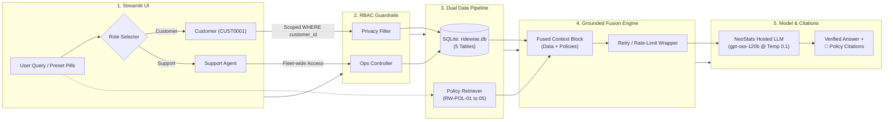

# RideWise Assist 🛵

A production-grade conversational AI assistant for **RideWise**, a Bengaluru-based two-wheeler and electric-vehicle rental company. 

The system serves both **Customers** (with strict privacy and account boundaries) and **Support Agents** (with fleet-wide operational visibility) using a unified SQLite database and 5 official policy documents.

---

## 🏛️ System Architecture



---

## 🚀 Quickstart Setup (< 5 Minutes)

### 1. Prerequisites
- Python 3.10+ (tested on Python 3.13)
- Git

### 2. Clone Repository & Set Up Virtual Environment
```bash
git clone <repository_url>
cd ridewise-assist

python -m venv venv
# On Windows:
.\venv\Scripts\activate
# On macOS/Linux:
source venv/bin/activate
```

### 3. Install Dependencies
```bash
pip install -r requirements.txt
```

### 4. Configure Environment Variables
Copy `.env.example` to `.env`:
```bash
cp .env.example .env
```
Fill in the credentials provided by NeoStats:
```ini
NEOSTATS_ENDPOINT=https://neo-hackathon.services.ai.azure.com/openai/v1/
NEOSTATS_API_KEY=your_event_api_key_here
NEOSTATS_MODEL=Neo-Hackathon
```

### 5. Launch the Web Application
```bash
streamlit run app.py
```
Open **http://localhost:8501** in your browser.

---

## 🛡️ Key Features & Guardrails

1. **Role-Based Access Control (RBAC):**
   - **Customer Role**: Scoped strictly to the active `customer_id`. Can access their own profile, bookings, payments, and damage claims. Strictly prevented from seeing other customers' PII or internal fleet metrics.
   - **Support Agent Role**: Operational access to look up any booking, vehicle statuses across all 7 Bengaluru hubs, and damage reports.
2. **Policy Versioning Intelligence:**
   - Evaluates the `booked_at` timestamp:
     - Bookings before 1 July 2026 follow **Cancellation Policy v1 (RW-POL-02)**.
     - Bookings on or after 1 July 2026 follow **Cancellation Policy v2 (RW-POL-03)**.
3. **Exact Penalty Calculations:**
   - Accurately computes late return penalties ($1.5 \times \text{hourly rate}$ per late hour or part-hour).
   - Enforces tier grace periods (e.g., Gold tier 30-min grace period; charges from minute 1 if lateness exceeds 30 minutes).
   - Accurately applies EV low battery fees (<10% incurs ₹150 flat fee; 10% or above incurs ₹0 fee).
4. **Verifiable Citations:**
   - All responses include expandable references citing document codes (`RW-POL-01` to `RW-POL-05`) or database tables.
